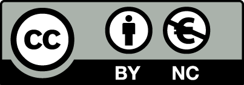

# Go with AI

## はじめに

このハンズオンでは、Google ADK (Agent Development Kit) for Goを使ってAIエージェントを作成する方法を学びます。
基本的なGoの文法などは、このハンズオンでは扱いません。

ADKについては、[ADK公式ドキュメント](https://google.github.io/adk-docs/)を参照してください。

## 事前準備

このハンズオンを行うには、以下の準備が必要です。

* Go 1.25以上のインストール
* [Google AI Studio](https://aistudio.google.com/) で API キーを取得し、環境変数 `GOOGLE_API_KEY` に設定

```bash
export GOOGLE_API_KEY="your-api-key"
```

## 学べることと学べないこと

このハンズオンを行うと以下のことが学べます。

* ADK Goの基本的な使い方
* LLMエージェントの作成方法
* 組み込みツール（Google検索）の使い方
* カスタムツールの作成方法
* MCPサーバーの作成と利用方法

一方、学べないことは以下のとおりです。

* Goの開発環境のインストール方法
* IDEやエディタの設定
* 基本的な文法
* 生成AIやLLMの仕組み
* プロンプトエンジニアリング

## ハンズオンのやりかた

`skeleton`ディレクトリ以下に問題があり、4つのステップに分けられています。
STEP 1からSTEP 4までステップごとに進めていくことで、ADK Goに関する知識が学べます。

各ステップに、READMEが用意されていますので、まずは`README`を読みます。
`README`には、そのステップを理解するための解説が書かれています。

`README`を読んだら、ソースコードを開き`TODO`コメントが書かれている箇所をコメントに従って修正して行きます。
`TODO`コメントをすべて修正し終わったら、`README`に書かれた実行例に従ってプログラムをコンパイルして実行します。

途中でわからなくなった場合は、`solution`ディレクトリ以下に解答例を用意していますので、そちらをご覧ください。

また、[NotebookLM](https://notebooklm.google.com/notebook/9ca82a13-be81-4ca7-97b2-20269df6c271)でハンズオンの内容について質問することもできます。

## 目次

* STEP 1: [はじめてのエージェント](./skeleton/step01)（[解答例](./solution/step01)）
* STEP 2: [Google検索ツールを使う](./skeleton/step02)（[解答例](./solution/step02)）
* STEP 3: [カスタムツールを作る](./skeleton/step03)（[解答例](./solution/step03)）
* STEP 4: [MCPサーバーを作る](./skeleton/step04)（[解答例](./solution/step04)）

## ハンズオンの開催や資料の扱いについて
この資料を元にハンズオンを開催するために@tenntennの許可などはいりません。
好きに開催してください。
@tenntennの行ける範囲であれば、開催するから解説して欲しいという依頼もウェルカムです。

なお、forkして変更してもらっても構いませんが、できればPRをいただけると嬉しいです。
資料に間違えを発見した方もissueやPRを頂ければ対応します。

## ライセンス

<a href="https://creativecommons.org/licenses/by-nc/4.0/legalcode.ja">
	
</a>
